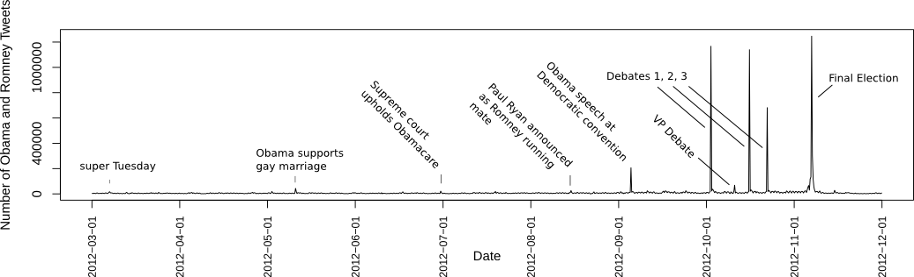

I was looking at the spikes in twitter traffic about Obama and Romney
during the 2012 US presidential election. So far this is just volumes of
tweets containing “obama” and/or (logical or) “romney” (case
insensitive), but in the future I would like to do similar plots for
sentiment.

[](/assets/wordpress/2012/12/electiontimeline_annotated.png)

The data this is based on 315,000,000 tweets, which was more than 1TB
when including all the metadata.  Only the subset of these matching
“obama” or “romney” were used for the chart, but still it took 11 hours
to tabulate the results on my desktop computer (the one that I mentioned
in [the previous post](/posts/raid-setup/index.qmd "raid setup")).

This plot was made using [R](http://www.r-project.org/ "R") and
[Inkscape](http://inkscape.org/ "inkscape").  Here’s the [input data
table](http://racer5.usc.edu/~abe/twitterElectionTimeline_tsvWithHeader.txt "twitter election timeline"),
and here’s a gist of the R code :

``` r
# Read in data
timeSeriesElectionData <- read.table("twitterElectionTimeline_tsvWithHeader.txt",header=TRUE)

# Attach columns of data as variables in R environment
attach(timeSeriesElectionData)

# open a pdf file for writing
pdf(file="electionTimeline.pdf",height=4,width=12)

# plot the sum of tweets about obama and romney, as a line, with no x-axis ticks, bla bla... 
plot(obama+romney, type='l',xaxt='n',xlab='Date',ylab="Number of Obama and Romney Tweets")

# create a sequence of dates, from Mar. 1 to Dec. 1, by month
d <- seq.Date(from=as.Date('2012-3-01'), to=as.Date('2012-12-01'),by='month')

# find the number of data points:
length(obama)
# output: [1] 1068

# write the dates as axis ticks
axis(side=1,labels=d,at=seq(from=1,to=1068,length.out=10),cex.axis=0.8,las=2)

#close the pdf file
dev.off()
```

[Original code on GitHub Gist](https://gist.github.com/abecode/4289867)

---

Originally published on [abewrites](https://abewrites.wordpress.com/2012/12/14/2012-us-presidential-election-timeline-in-twitter/).
