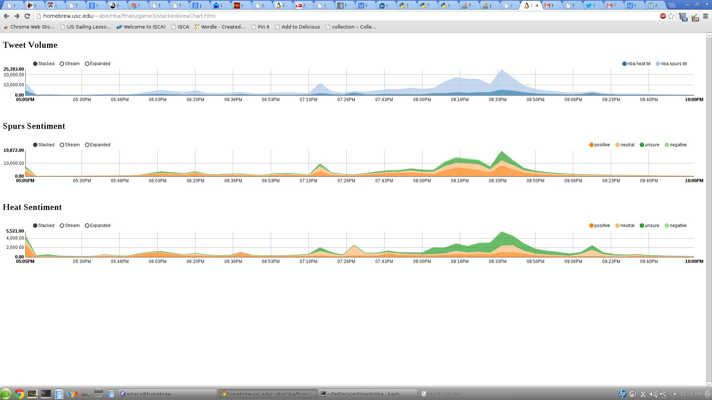

Here is some preliminary results of some analysis of Twitter data about
the NBA Finals between the Miami Heat and San Antonio Spurs.  First we
tracked tweets containing \#spurs, \@spurs, and \#gospursgo for the Spurs
and \#miamiheat and \@miamiheat for the Heat, based
on <http://www.vegau.com/resources/NBA-twitter-hashtags/> .

In this the Spurs won in a blow out, pretty much starting in the second
quarter.  So far the interesting things I noted were that people tend to
tweet during the half time and after the game (7:10 and 8:31).
 Comparing this game with the
[previous](http://homebrew.usc.edu/~abe/nba/finals/game2/stackedAreaChart.html "nba finals game 2") game,
it seems that the winners tended to get more tweets.  But that’s not to
say that there is causation or even direct correlation b/c we could also
say that the home team got more tweets in both cases.

Here are some salient timestamps that Jon and I identified during the
game.

6:15-Duncan dunk -Spurs up by 7\
6:21-good LeBron James play -Miami coming back\
6:49-Danny Green 3 pointer-Spurs go up by 8\
6:57-spurs go up by 10\
7:01-Neal 3 pointer,Spurs by 11\
7:09-heat tie it up\
7:10-Neal hits at buzzer spurs up at halftime\
7:43-largest spurs lead of the night

7:58: End of third, 758

8:05-Timeout

8:09-Spurs slam dunk\
8:10-Spurs 3 point

8:16-Spurs 3 point

8:16-Spurs dunk\
8:18-Spurs 3 point\
8:22-Heat 3 point\
8:22-Time out\
8:29-Spurs dunk\
8:31-Game over

---

Originally published on [abewrites](https://abewrites.wordpress.com/2013/06/12/analysis-of-social-media-for-nba-finals/).
