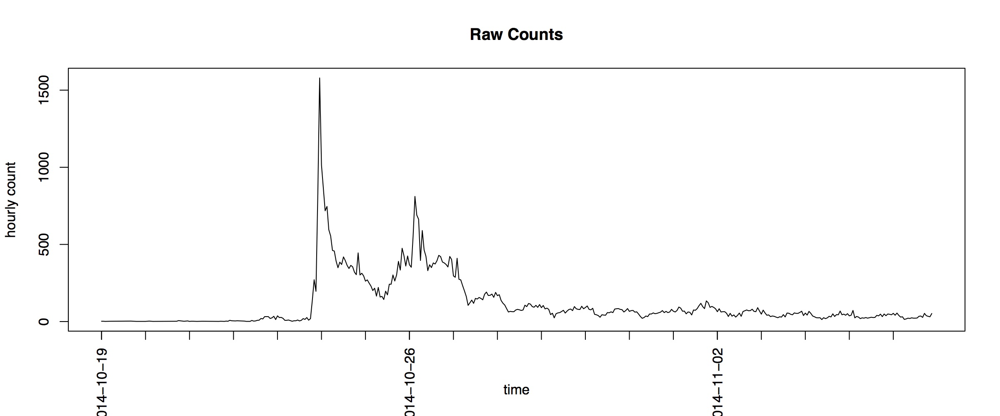
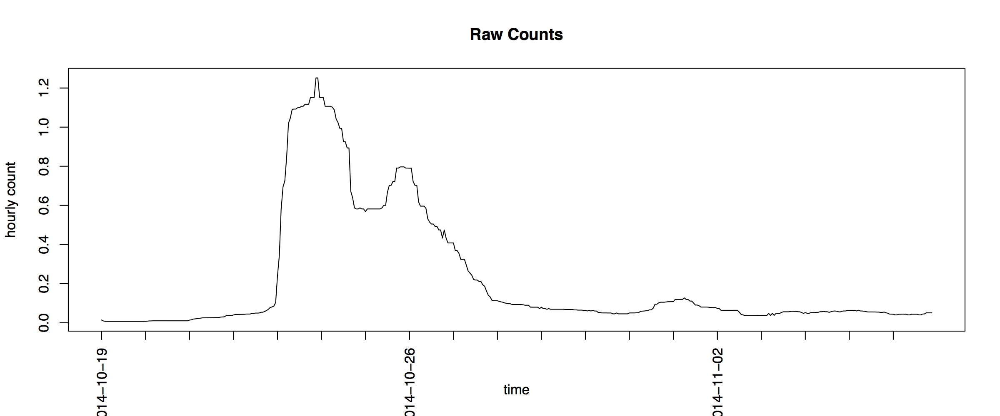
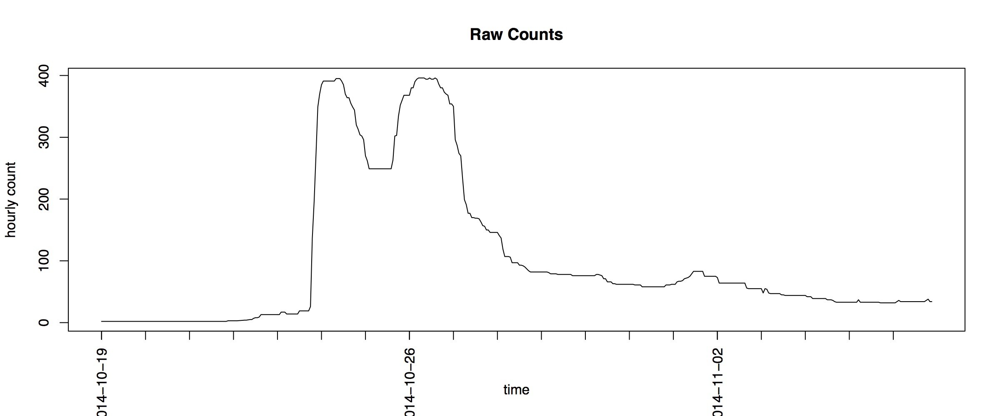

Social signals generated from users tends to follow a diurnal pattern
where there’s activity at certain hours of the day and lulls at others.
 This pattern is interesting but often it is other patterns that are
more salient, like spikes  in traffic.  When the spikes are combined
with the diurnal fluctuations, we have a signal separation problem.  In
this framing of the problem, the observed web traffic is modeled as an
underlying trend signal multiplied by the harmonic noise of daily
fluctuations.  Multiplication in the time domain is equivalent to
addition in the frequency domain.  So to recover the underlying trend
signal we subtract the average frequency spectrum from the daily
observed frequency spectrum.

It turned out that this was an easy problem to solve in R, so I wanted
to share my experience.  First, to visualize the process below is an
example of a snippet of the observed signal over about 3 weeks.

[](/assets/wordpress/2015/03/hourly_app_status_snip_raw.jpg)

[hourly_app_status_snip_raw](/assets/wordpress/2015/03/hourly_app_status_snip_raw.pdf)

you can see that there are several big spikes as well as smaller daily
bumps.  The goal is to remove the  daily bumps so that we can see
underlying trends.  To do that, we use the FFT to convert the signal to
the frequency spectral domain, average the the daily spectra, then
subtract the average from the observed daily spectra.  One of the cool
things about R is that the FFT is a built in function.  However, we had
to import a library for the Hamming window.  The daily spectra
correspond to sliding windows of one day length.  The edges of the
window need to be rounded to prevent artifacts, which is what the
Hamming window is needed for. library(‘e1071’) (line 5) imports the
Hamming window and library(zoo) imports ‘rollapply’ (line 2), the
function that applies the window across the signal (line 14).

``` r
# needs zoo for "rollapply"
library(zoo)

# needs e1071 for Hamming window
library('e1071')

# load data
th <- read.csv2('app_status_report_hourly.csv', header=F, sep=',', col.names=c('time','count'))

# normalize the data by the maximum
X <- th$count[1:length(th$count)]/max(th$count)

# 
Xw <- rollapply(X,24,by=1,function(x){x*hamming.window(24)})
Fw <- apply(Xw,1,fft)
Fw_avg <- colMeans(t(abs(Fw)))
Fw_rem <- Fw - Fw_avg
Xw_rem <- apply(Xw,1,fft,inverse=T)
X_rem <- vector(mode=typeof(Xw_rem),length=length(X))
for(i in seq(1, dim(Xw_rem)[2])){
  X_rem[i:(i+23)] <- X_rem[i:(i+23)] + Xw_rem[,i]
}
# plot(abs(X_rem),type='l') # the recovered with high frequency artifacts
plot(runmed(abs(X_rem), 25), type='l')
plot(runmed(abs(X), 25), type='l') #compare with simple median smoothing
```

[Original code on GitHub
Gist](https://gist.github.com/abecode/ba31e14ff4d5915ff877)

The output looks like this:

[](/assets/wordpress/2015/03/hourly_app_status_snip_remavgspectrum.jpg)

[hourly_app_status_snip_remAvgSpectrum](/assets/wordpress/2015/03/hourly_app_status_snip_remavgspectrum.pdf)

One question that comes up is how this compares to just plain old median
smoothing.  Median smoothing is already a part of the code to generate
the output because it acts as a low frequency filter to remove high
frequency artifacts from cutting up and reassembling the signal.  But
what if we just apply plain old median smoothing to the original
smoothing without the FFT.  The result of just using median smoothing
looks like this.

[](/assets/wordpress/2015/03/hourly_app_status_snip_onlysmoothing.jpg)

[hourly_app_status_snip_onlySmoothing](/assets/wordpress/2015/03/hourly_app_status_snip_onlysmoothing.pdf)

Subjectively, it seems to me that the FFT frequency subtracted signal
shows a bit more resolution and does a better job of removing the DC
(constant) component of the signal.

---

Originally published on [abewrites](https://abewrites.wordpress.com/2015/03/05/fun-with-fft-at-vixlet/).
