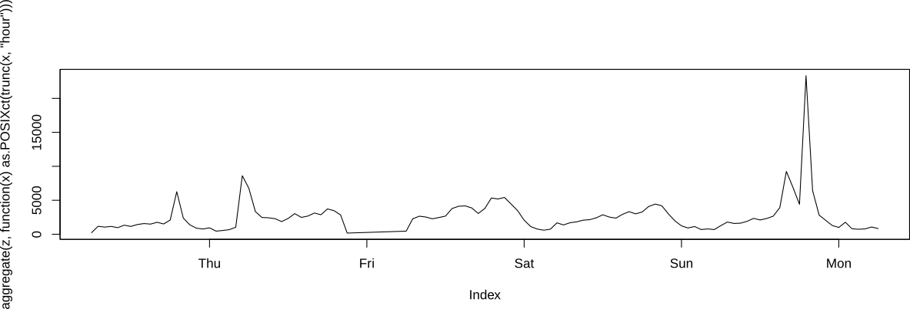

[](/assets/wordpress/2013/01/moviesfrom20130111.png)

In the last post, I aggregated the counts of tweets in python and
generated a table that I used in R.  This time I wanted to go from the
raw input of tweets and the output of sentiment analysis to aggregated
hourly counts using R, and this time for movies that came out on Jan 11,
2013 (Gangster Squad, Zero Dark Thirty, and A Haunted House.

Do this in R turned out to be harder than I expected and I had to
install some libraries, namely “zoo” (which stands for “z ordered
observations”)and “chron”, which can be seen in lines 1-5 in the gist
below\*.  I also had to massage the data a little more than I was
expecting.  After reading it in (line 8),  I had to muck around with
making the tweet column be character strings instead of factors, and
parsing the date info into a zoo object.  Line 20 actually does the
aggregation.  After plotting it, I noticed a spike on Sunday evening.
 It turned out there was a lot of (re)tweets about Zero Dark Thirty and
one about a ticket give-away for Gangster Squad:

“RT \@goldenglobes: Best Actress in a Motion Picture – Drama – Jessica
Chastain – Zero Dark Thirty – \#GoldenGlobes”\
“RT \@vuecinemas: Help stop the mob with \#GangsterSquad on Jan 10th! To
win one of 5 movie packs, follow us and retweet this message by 5p …”\
“Woot! RT \@Bad_Wobot1013: Awesome Jessica Chastain!! ”

``` r
# install and load additional packages
install.packages("zoo")
install.packages("chron")
library(zoo)
library(chron)

# read in data
dt <- read.delim("movieReports/20130109_to_20120113.tsv",header=TRUE,sep="\t",comment.char="",quote="",na.strings="",fileEncoding="UTF-8")

# convert the tweet column from a factor (default) to a character string
dt$tweet<-as.character(dt$tweet)

# add a dummy variable for counts
dt<-transform(dt, dummy=1)

# create a zoo object (after many unsuccessful tries)
z <- zoo(dt$dummy,order.by=as.chron(as.character(dt$postedTime),format="%Y-%m-%dT%H:%M:%OSZ",tz="GMT"))

# aggregate by passing a function that uses another R time functionality
aggregate(z,function(x) as.POSIXct(trunc(x,"hour")) )

# plot the time series (by default this will open a popup window
plot(aggregate(z,function(x) as.POSIXct(trunc(x,"hour")) ))

# this will change the times to Pacific time, from GMT (perhaps there is a better way)
plot(aggregate(z,function(x) as.POSIXct(trunc(x-(8/24),"hour")) ))

#this will save the 

# I was interested in a spike that I saw at 2013-01-13 19:00:00:
spike<-dt[as.POSIXct(trunc(time(z),"hour"))==as.POSIXct("2013-01-13 19:00:00"),]

# this sorts the tweets from the spike by retweet count
spike[with(spike,order(retweetCount)),1]
# output of top retweetedTweets:
# [23340] "RT @goldenglobes: Best Actress in a Motion Picture - Drama - Jessica Chastain - Zero Dark Thirty - #GoldenGlobes"                                                   
#[23341] "RT @vuecinemas: Help stop the mob with #GangsterSquad on Jan 10th! To win one of 5 movie packs, follow us and retweet this message by 5p ..."                       
# [23342] "Woot! RT @Bad_Wobot1013: Awesome Jessica Chastain!! "    
```

[Original code on GitHub Gist](https://gist.github.com/abecode/4562764)

\*Note that if you’re using Linux, you’ll need to have the R-devel
packages to build this libraries in the installation process

---

Originally published on [abewrites](https://abewrites.wordpress.com/2013/01/18/hourly-counts-of-movie-tweets-using-r/).
