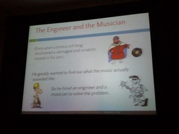
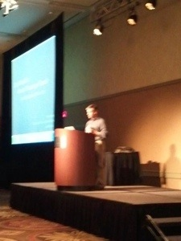

The second tutorial I attended was about topic models for acoustic data,
given by Bhiksha Raj and Paris Smaragdis. Normally topic models are
applied to text data but the examples for audio are very compelling. The
applications include noise removal, speaker separation, reverberation
removal, and creation of features for speech recognition. There were
lots of cool, even mind-blowing, demos. The one drawback was that the
references were not given inline but rather in a big small font slide at
the very end so they were not very useful. One of the main things that I
learned that I want to try in my work is the use of entropic proofs
instead of Dirichlet priors in the project I’m presenting here. I was
only able to find the first half of the presentation
[online](http://www.csee.ogi.edu/~zak/istut12/TopicModelForSpeech-Part1.pdf "interspeech 2012 topic models for speech part 1").

---

Originally published on [abewrites](https://abewrites.wordpress.com/2012/09/09/interspeech-2012-day-0-tutorial-on-topic-models-for-acoustic-data/).
