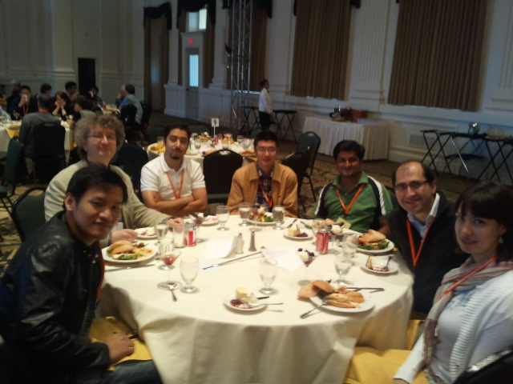
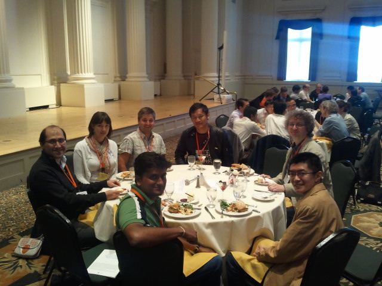

Today the key note speaker was Roger Dannenberg, who presented about
music understanding and the future of music performance.  It was a
pretty interesting talk and it even included him playing his trumpet in
a demo.  It included both instrumental and speech/voice based
applications and presented a good point about how big a market this area
is.

I didn’t make any notes about the presentations today but I was asked to
be a reporter for the student industry academic lunch (that is why I
decided to blog about the rest of the conference in the first place–glad
I did b/c it helps to reinforce the memory of all the things that I saw,
even though it was a bit of work).

The student lunch at the table I was assigned to was hosted by Murat
Saraclar (Google and Bogazici University) and Gareth Jones (Dublin City
University) and the topic of discussion was spoken term detection and
spoken document retrieval.  The students that were attending were:
Tsung-Hsien Wen (National Taiwan University), Deepak Krishnarajanaga
Thotappa (IIT Guwahati),  Haiyang Li (Harbin Institute of Technology),
Atta Norouzian (McGill), Hungya Lee (National Taiwan University), Maria
Eskevich (Dublin City University), and myself, Abe Kazemzadeh (USC SAIL
Lab). We spent most of the time doing introductions and learning about
each other’s research, but later it became more of a conversational
discussion.  Some topics that came up in the discussion were:

- the differences between term detection and document retreival
- differences in data sources, e.g., broadcast news vs. meeting data
- discriminative language models
- the work of Amit Singhal at Google
- Malach corpus of spoken video interviews
- an [older NIST overview paper on spoken document
  retrieval](http://www.nist.gov/manuscript-publication-search.cfm?pub_id=151423)

Here are some pictures of the student lunch:

Also, today was the student reception at the crystal ballroom.  I got
side-tracked and ended up at a concert by Tango Alpha Tango at the
crystal hotel, which was next to the place that I was supposed to go.
 The concert was pretty good and I did finally make it to the tail end
of the student reception.  The dance floor of the crystal ball room was
on springs or something, so it was almost like a trampoline.
 Unfortunately no one was dancing.

---

Originally published on [abewrites](https://abewrites.wordpress.com/2012/09/11/interspeech-2012-day-2/).
