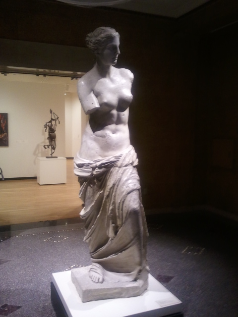
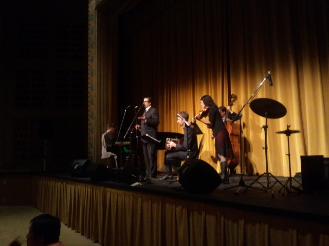
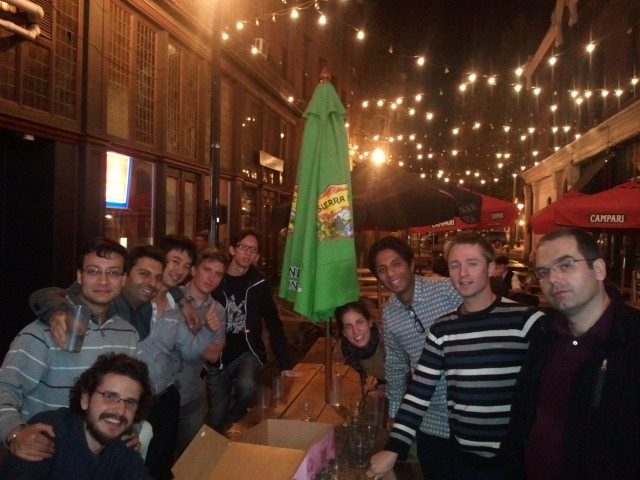
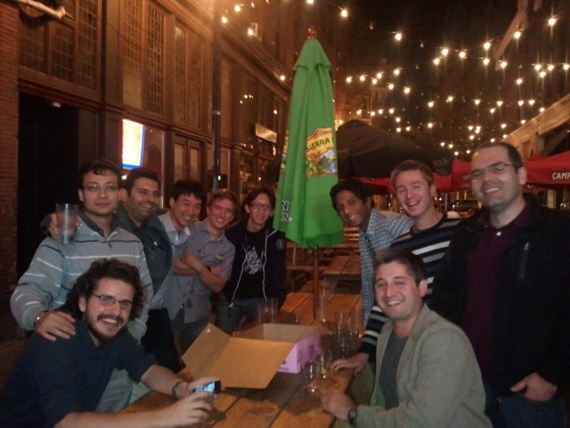

Today the keynote speaker was Michael Riley from Google, who talked
about openfst and some of the new aspects of their work.  Most of the
talk was a bit too basic for people that know about fst’s and to
advanced for people who don’t, but it was still interesting as a
refresher.  I was most interested in the push-down automata/transducers
that they added to openFST recently.  Also, the discussion about some of
the tradeoffs in the design of FSTs was interesting, e.g., time vs.
space, static vs. dynamic machines, and centralized vs. distributed
algorithms.  Also, the discussion about the different types of
artificial languages and how they relate to parser types was
interesting.  The idea was that with a pushdown automaton, the
determinization/minimization/epsilon removal is no longer unique and
different strategies result in different types of parsers, like Early,
Cyk, etc.  I think I would get more out of this talk if I refreshed my
knowledge of parser types.

One of the sessions that caught my attention was the language modelling
session.  I missed the talk on paraphrastic language models, but I read
some of the paper and it seems very promising to read in more detail.
 The IBM talk on neural network language models was interesting and it
was pretty funny that some of their models took 50 days to train.  The
main results for this work were training speedups rather than
performance increases.  The low rank plus sparse talk was also very
compelling model and interesting talk.  I want to reexamine some of my
work in light of this (the fuzzy logic model of emotion dimensions seems
analogous to the  continuous low-rank component, and the emo20q
question-answer based model analogous to the discrete, sparse
component).

The reception at the Portland art museum was very nice.  The museum was
had a lot of beautiful art and there was a tango  band in the upstairs
ballroom that I enjoyed with a researcher from Toyota that was a Tango
fan.  Here are some pictures of the reception.

  
last week I actually visited where the original Venus/Aphrodite de Milo
was found (Milos Island, Greece)

<!-- -->

  
Tango band

After the reception, the sailers went out for drinks.  Here are some of
the pictures that are fit for the public 🙂

last week I actually visited where the original Venus/Aphrodite de Milo
was found (Milos Island, Greece)

Tango band

---

Originally published on [abewrites](https://abewrites.wordpress.com/2012/09/12/interspeech-2012-day-3/).
