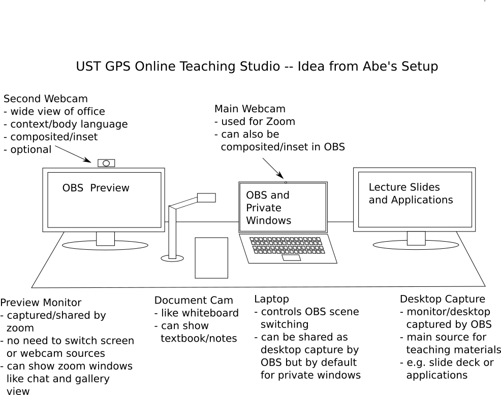

I've actually been enjoying teaching online during Covid-19.  Besides
the ability to have a soundtrack/theme (Between Two Ferns) and sound
effects (applause and various boing noises from a midi keyboard), I've
enjoyed using [OBS Studio](https://obsproject.com/) a lot.  Below is a
schematic diagram of the setup I use for teaching using OBS and Zoom
Pro:

Here's the splash screen with arcade classic font that's made to look
like [Between Two
Ferns](https://en.wikipedia.org/wiki/Between_Two_Ferns_with_Zach_Galifianakis#/media/File:Between_Two_Ferns_with_Zach_Galifianakis.png) (typo partially intentional) :

